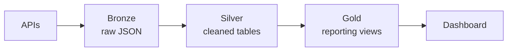

# Input Cost Monitor

A daily pipeline that tracks the cost of imported raw materials for a UK manufacturer, and splits each change into what came from the supplier's price and what came from the exchange rate.

Built with Python, SQL, Azure and GitHub Actions.

## Background

Midlands Precision Components Ltd (a fictional company) makes machined metal parts for the automotive and industrial sectors. It imports most of its raw metal and pays in foreign currencies.

At the moment, cost increases are only discovered when supplier invoices arrive, which is too late to renegotiate, buy early or adjust customer quotes. The Head of Procurement and the finance team want an earlier warning.

This project answers two questions:

1. How much has the cost of each material changed?
2. How much of that change came from the supplier's price, and how much from the exchange rate?

## Scope

- **Materials:** Steel, aluminium, copper
- **Countries:** China, Germany, USA
- **Currencies:** USD, EUR, CNY, converted to GBP
- **Grain:** One row per material, country and month
- **History:** At least 3 years
- **Refresh:** Daily

Not included: real company data, price forecasting and automated buying decisions.

## Metrics

- Cost per kg in GBP, by material and country
- Month-on-month % change
- Price effect vs currency effect

## Data sources

| Source | Used for | Updates |
|---|---|---|
| [UN Comtrade](https://comtradeplus.un.org/) | UK import values and weights, used to calculate price per kg | Monthly |
| [Frankfurter](https://www.frankfurter.app/) | Exchange rates | Daily |
| [ONS](https://www.ons.gov.uk/) | UK producer price inflation, used as a benchmark | Monthly |

## Architecture

- **Bronze:** raw API responses saved unchanged in Azure Blob Storage, so the data can always be reprocessed.
- **Silver:** cleaned and deduplicated tables in Azure SQL, with units converted to kg and prices to GBP.
- **Gold:** SQL views that answer the two questions above.
- The pipeline runs daily on a GitHub Actions schedule.

## Roadmap

- [x] Business brief and repo setup
- [ ] Ingest exchange rates, Comtrade and ONS data into Bronze
- [ ] Clean and load into Azure SQL (Silver)
- [ ] Reporting views and dashboard (Gold)
- [ ] Tests, CI and daily schedule
